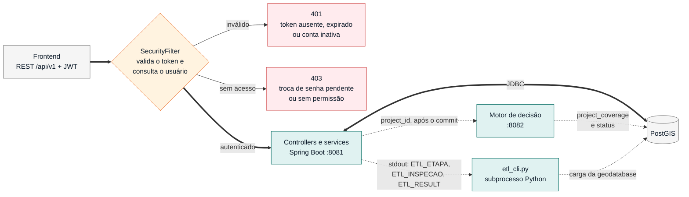
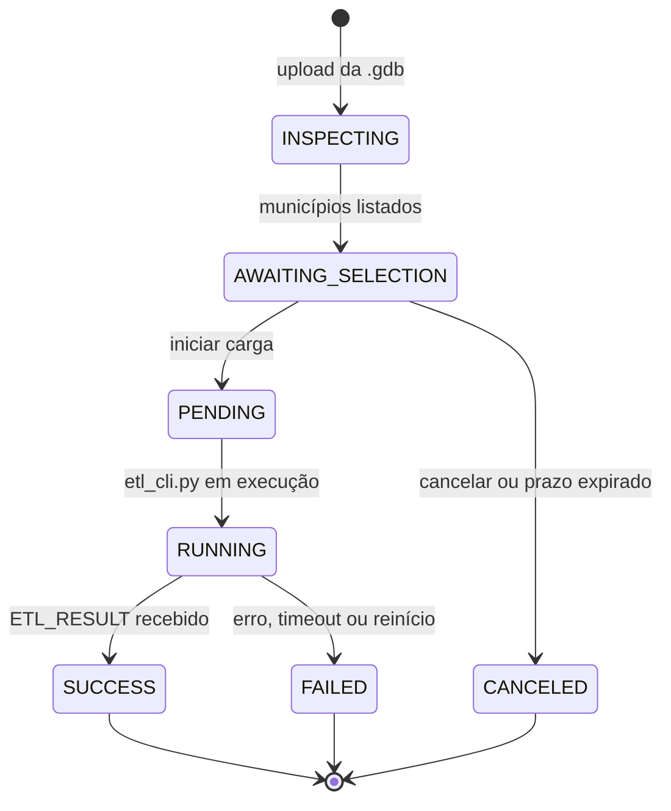

# Backend (Tecsys API)

API REST em Spring Boot 3.3 / Java 17. Autentica usuários por JWT, expõe os dados da rede elétrica ao frontend, orquestra a carga de dados (ETL) e dispara o motor de decisão.

## 1. O que faz e com quem conversa

| Interlocutor | Direção | Canal | Finalidade |
|---|---|---|---|
| Frontend | entrada | HTTP REST `/api/v1/*` (porta 8081), JWT em `Authorization: Bearer` | Todas as funcionalidades do app |
| PostgreSQL/PostGIS | saída | JDBC (Hikari, pool de 8) | Usuários, projetos, rede elétrica, resultados, jobs de ETL |
| Motor de decisão | saída | HTTP `POST {ENGINE_URL}` com `{"project_id": N}`, assíncrono | Disparar o cálculo de cobertura |
| ETL (`modules/etl_cli.py`) | saída | Subprocesso Python; protocolo por stdout | Carga da geodatabase e dos consumidores |

O backend **não** calcula cobertura: ele cria o projeto, aciona o motor e depois serve o resultado que o motor gravou em `project_coverage`.

Caminho de uma requisição e as integrações do backend:



## 2. Como executar e testar

### Via Docker (recomendado)

Na raiz do repositório:

```bash
./scripts/run-db.sh                      # banco local (precisa do db/bdgd.dump na 1ª vez)
./scripts/run-backend.sh                 # backend contra o PostGIS local
./scripts/run-backend.sh --db supabase   # backend contra o Supabase
./scripts/run-backend.sh --stop
```

Pré-requisito: `API_SECURITY_TOKEN_SECRET` definido no ambiente ou em `.env` na raiz (`openssl rand -hex 32`). Detalhes de imagem, rede e Supabase em [`DOCKER.md`](DOCKER.md).

### Localmente (sem Docker)

Requer JDK 17 e um PostgreSQL com PostGIS e `pgcrypto`.

```bash
cd Backend/tecsys
cp .env.properties-example .env.properties   # preencher DB_URL, DB_USER, DB_PASSWORD
export API_SECURITY_TOKEN_SECRET=$(openssl rand -hex 32)
./mvnw spring-boot:run
```

O Flyway aplica as migrations no startup. A documentação OpenAPI fica em `http://localhost:8081/swagger-ui.html`.

Para executar cargas de ETL localmente, o backend precisa de Python com as dependências de `modules/requirements.txt` e da variável `ETL_DB_URL` (formato SQLAlchemy) no ambiente. O caminho padrão do script (`../api-5/modules/etl_cli.py`) pressupõe que o repositório esteja numa pasta chamada `api-5`; use `ETL_SCRIPT_PATH` caso contrário.

### Variáveis de configuração

| Variável | Padrão | Descrição |
|---|---|---|
| `DB_URL`, `DB_USER`, `DB_PASSWORD` | obrigatórias | Conexão JDBC |
| `API_SECURITY_TOKEN_SECRET` | obrigatória | Segredo HMAC do JWT; mínimo de 32 bytes, senão a aplicação não inicia |
| `BACKEND_PORT` | `8081` | Porta HTTP |
| `ENGINE_URL` | `http://localhost:8082/api/calculate` | Endpoint do motor |
| `ETL_PYTHON` | `python` | Executável Python do ETL |
| `ETL_SCRIPT_PATH` | `../api-5/modules/etl_cli.py` | Caminho do `etl_cli.py` |
| `ETL_TIMEOUT_MINUTES` | `120` | Tempo máximo de uma carga |
| `ETL_DB_URL` | n/a | Banco onde o ETL grava (SQLAlchemy: `postgresql+psycopg2://...`) |

`.env.properties` é lido via `spring.config.import` e não deve ser versionado.

### Testes

```bash
cd Backend/tecsys
./mvnw test -Dtest=TokenServiceTest   # unitário, sem banco
./mvnw test                           # inclui TecsysApplicationTests (@SpringBootTest): exige DB_* e o segredo do JWT
```

`TokenServiceTest` cobre rejeição de segredo vazio ou curto e o ciclo de geração e validação do token. A cobertura de testes do módulo é restrita a esse serviço.

## 3. Resumo de funcionalidades

Todas as rotas exigem JWT, exceto `POST /api/v1/auth/login` e a documentação OpenAPI.

| Domínio | Endpoints | Acesso |
|---|---|---|
| Autenticação | `POST /api/v1/auth/login`, `POST /api/v1/auth/change-password` | login público; troca de senha autenticada |
| Usuários | `POST/GET /api/v1/users`, `GET /api/v1/users/{id}`, `POST /api/v1/users/batch`, `DELETE /api/v1/users/{id}`, `GET /api/v2/users` | `ADM` |
| Distribuidoras | `GET /api/v1/distribuidoras`, `GET /api/v1/distribuidoras/{dist}/municipios` | autenticado |
| Bairros | `GET /api/v1/bairros` (sugestões para o filtro) | autenticado |
| Pontos | `POST /api/v1/points/filter`: filtro espacial e de atributos; modos contagem, agrupado em grade e pontos individuais | autenticado |
| Projetos | `POST/GET /api/v1/projects`, `GET/PUT/DELETE /api/v1/projects/{id}` (ordenação `sort=recent`, `limit`); `GET /api/v1/projects/{id}/history` (versões); `POST /api/v1/projects/{id}/recalculate` (nova versão e reenvio ao motor); `POST /api/v1/projects/{id}/activity` (registra abertura, ordena os Recentes) | autenticado |
| Simulação | `POST /api/v1/simulation/run`: cria o projeto, registra polígono e filtros e aciona o motor | autenticado |
| Relatórios | `GET /api/v1/reports/projects/{projectId}/coverage` | autenticado |
| ETL | `POST /api/v1/etl/upload-gdb` (multipart), `POST /api/v1/etl/upload-csv` (pontos externos, #TG-89), `GET /api/v1/etl/jobs`, `GET /api/v1/etl/jobs/{id}`, `POST /api/v1/etl/jobs/{id}/iniciar`, `POST /api/v1/etl/jobs/{id}/cancelar` | `ADM` |

Estados de um projeto (`ProjectStatus`): `CRIADO` → `ENVIADO` → `PROCESSANDO` → `SUCESSO` ou `FALHA`. As três últimas transições são do motor.

Estados de um job de ETL (`EtlJobStatus`): `INSPECTING` → `AWAITING_SELECTION` → `PENDING` → `RUNNING` → `SUCCESS` ou `FAILED`; `CANCELED` para uploads descartados.



Papéis (`UserRole`): `ADM` e `USER`. Seed inicial: `admin@tecsys.com.br` (migration V9).

## 4. Decisões técnicas e arquitetura

**Autenticação stateless.**
- Token JWT assinado com HMAC-SHA256 (`java-jwt`), emissor `tecsys-api`, claim `role`, validade fixa de 2 h, sem refresh token.
- `SessionCreationPolicy.STATELESS`, CSRF desabilitado, senhas com BCrypt.
- O segredo é validado no construtor do `TokenService`: menos de 32 bytes impede o startup (#TG-94).

**`SecurityFilter` consulta o usuário a cada requisição.**
- Conta desativada ou excluída perde o acesso imediatamente, mesmo com token válido (401).
- Usuário com `must_change_password` só acessa `/api/v1/auth/change-password` (403 nas demais).
- Custo: uma consulta por requisição autenticada.

**Semântica de 401 e 403.** 401 indica ausência, expiração ou invalidez do token (o frontend desloga). 403 indica usuário autenticado sem permissão (`@PreAuthorize("hasRole('ADM')")`, via `@EnableMethodSecurity`).

**Schema versionado só pelo Flyway.** Migrations `V1` a `V15` em `src/main/resources/db/migration`; `spring.jpa.hibernate.ddl-auto=validate`. Alterações de schema entram como nova migration.

**Integração assíncrona com o motor.** `DecisionEngineClient` envia o `project_id` sem esperar o cálculo e só depois do commit da transação (`sendAfterCommit`, #TG-96), para o motor sempre encontrar o projeto e a versão do histórico. O estado é compartilhado pelo banco: o motor atualiza `projects.status` e grava `project_coverage`; o frontend consulta por polling. Se o motor estiver fora do ar ou responder com erro HTTP, o backend marca o projeto como `FALHA` com a mensagem do motivo, para ele não ficar em `ENVIADO` para sempre; o usuário pode recalcular.

**Exclusão lógica de projetos.** `DELETE /projects/{id}` marca `active = false`; as consultas filtram por `active = true`.

**Filtro de pontos em SQL dinâmico.** `PointCustomRepository` monta um `UNION ALL` entre as tabelas das camadas selecionadas e aplica distribuidora, município, polígono e viewport (`ST_Intersects`). No modo agrupado, aplica `ST_SnapToGrid(ST_PointOnSurface(geom), cluster_cell)` e devolve um ponto por célula com a contagem, o que mantém o payload limitado em zoom afastado. Rede e subestações só são retornadas com o mapa em zoom de detalhe.

**ETL como subprocesso.**
- O backend executa `etl_cli.py` e lê o stdout por prefixos: `ETL_ETAPA:` (etapa atual), `ETL_INSPECAO:` (resultado da inspeção) e `ETL_RESULT:` (resumo final).
- No máximo uma carga ativa por vez, garantido pelo índice único parcial `uq_etl_jobs_um_ativo` (V10).
- Ao iniciar, `EtlJobRecovery` marca como `FAILED` os jobs deixados em andamento por um reinício e descarta uploads cuja pasta de trabalho não existe mais.
- Upload multipart de até 4 GB (`spring.servlet.multipart`).

**Tratamento de erros.** `GlobalExceptionHandler` converte em respostas JSON padronizadas (`StandardError`) as exceções de regra de negócio, e-mail já cadastrado, validação de entrada, entidade não encontrada, credenciais inválidas, conta desativada e acesso negado; qualquer outra exceção cai no handler genérico.

**Limitações conhecidas.**
- CORS restrito a `http://localhost:*` (`SecurityConfig`); servir o frontend de outro host exige ajuste.
- Credencial de administrador de seed (`admin123`) deve ser trocada fora do ambiente de desenvolvimento.
- Convivem `/api/v1/users` e `/api/v2/users` (apenas `GET`).
