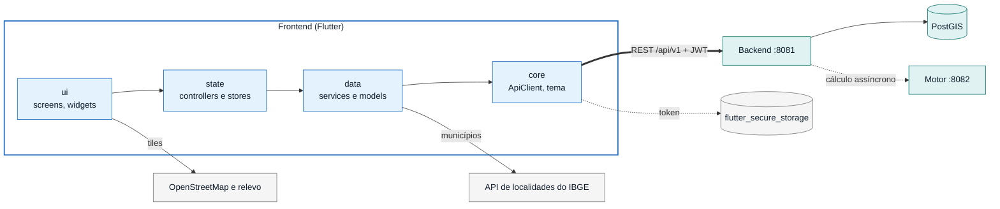
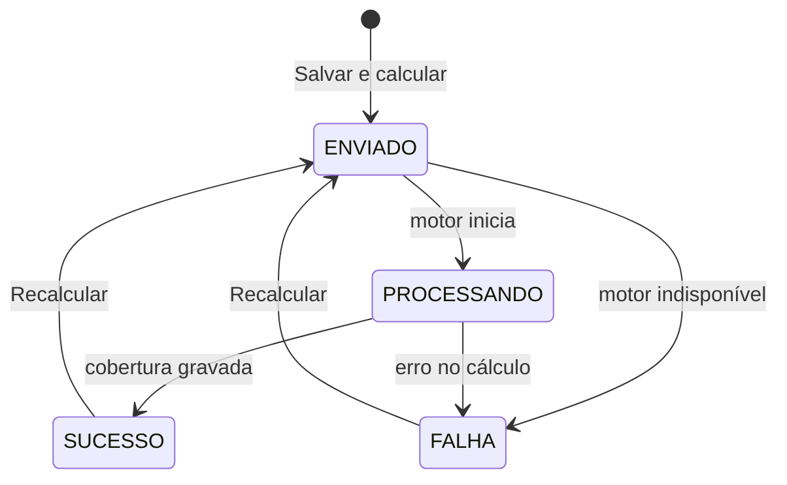
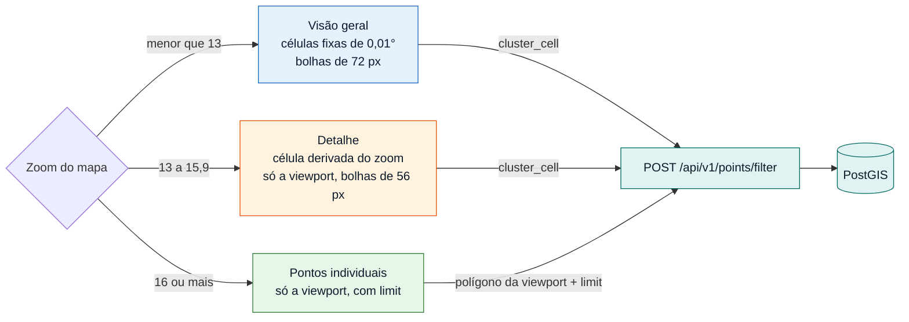

# Frontend (Tecsys App)

Aplicação Flutter (App  como alvo principal) para planejamento de cobertura de RF: autenticação, gestão de projetos, mapa de pontos, relatório de cobertura, carga de geodatabase (ETL) e gestão de usuários.

## 1. O que faz e com quem conversa

O app conversa **somente com o backend** (`/api/v1/*`, JWT em `Authorization: Bearer`). Não acessa o motor de decisão nem o banco.



Cada tela segue o mesmo caminho de dependência: `ui` lê o estado, `state` chama os `services` de `data`, e só o `ApiClient` (em `core`) fala HTTP.

| Interlocutor | Canal | Finalidade |
|---|---|---|
| Backend (`:8081`) | HTTP via `ApiClient` (pacote `http`) | Todas as operações de dados |
| Tiles do mapa | `flutter_map` + `latlong2` | Camada base (OpenStreetMap) e camada de relevo (`MapConfig.osmTileUrl`, `reliefTileUrl`) |
| API de localidades do IBGE | `ibge_service.dart` (`servicodados.ibge.gov.br/api/v1/localidades/municipios`) | Lista de municípios no formulário de novo projeto |
| Armazenamento seguro | `flutter_secure_storage` | Persistir token, papel, e-mail e nome entre sessões |

A URL do backend é definida **em tempo de build** (`--dart-define=API_HOST` e `API_PORT`; padrão `localhost:8081`). No emulador Android, o host é `10.0.2.2`.

## 2. Como executar e testar

### Via Docker

```bash
./scripts/run-frontend.sh                                  # API em localhost:8081, app em http://localhost:8080
./scripts/run-frontend.sh --api-host 192.168.0.10          # backend em outra máquina
./scripts/run-frontend.sh --api-host localhost --api-port 8081
./scripts/run-frontend.sh --stop
```

A imagem compila com o SDK do Flutter e serve os estáticos no nginx. Trocar de backend exige rebuild (o script já faz). Detalhes em [`DOCKER.md`](DOCKER.md).

### Localmente

Requer Flutter com Dart `>=3.3.0 <4.0.0` e o backend em execução.

```bash
cd Frontend
flutter pub get
flutter run -d chrome                                          # usa localhost:8081 por padrão
flutter run -d chrome --dart-define=API_HOST=192.168.0.10 --dart-define=API_PORT=8081
```

### Qualidade e testes

```bash
flutter analyze
flutter test
```

Testes em `test/`: aba salva (F5), histórico e avisos de carga ETL, escolha de municípios, controller do diálogo de novo projeto, modelo de projeto, cidades do projeto, papéis das camadas no mapa, abrir projeto no mapa, projetos recentes, exportação de relatório em PDF e smoke test do app.

### Login de desenvolvimento

`admin@tecsys.com.br` / `admin123` (perfil `ADM`).

## 3. Resumo de funcionalidades

| Funcionalidade | Diretório | Descrição |
|---|---|---|
| Autenticação | `lib/features/auth` | Login, troca de senha obrigatória no primeiro acesso, restauração de sessão (`splash_gate`), logout automático com aviso quando o token expira |
| Projetos | `lib/features/projects` | Lista com métricas, busca e filtro por status; seção **Recentes** (#TG-88); criação com distribuidora, municípios e filtros; atualização periódica do status; histórico de versões; abrir no mapa para ajustar e recalcular; exclusão |
| Mapa | `lib/features/map` | Pontos, candidatos e rede; filtros (camadas, classe, CNAE, bairro com autocomplete, cidades); papel de cada camada (pontos a cobrir ou candidatos a gateway, #TG-92); seleção de áreas; detalhe do ponto; salvar e disparar o projeto, ou recalcular um projeto aberto |
| Relatório | `lib/features/reports` | Indicadores de cobertura, gateways, eficiência, insights, mapa do resultado e exportação em PDF (`pdf`, `printing`) |
| ETL & Geodados | `lib/features/etl_geodados` | Upload de `.gdb`/`.zip` (com arrastar e soltar), escolha de municípios, acompanhamento por etapa, histórico de cargas; somente `ADM` |
| Usuários | `lib/features/users` | Listagem com métricas, filtro por papel e criação de usuários; somente `ADM` |
| Navegação | `lib/app` | Barras superior e inferior, menu de conta, retorno à aba ativa após F5 (web) |

### Ciclo de vida de um projeto

O app acompanha o status por polling e deixa recalcular a partir de qualquer estado: o mapa abre com a área, os filtros e as cidades da última versão (`GET /projects/{id}/history`), e cada recálculo grava uma versão nova (`POST /projects/{id}/recalculate`).



Abrir o relatório ou recalcular registra atividade (`POST /projects/{id}/activity`), e é isso que ordena a seção **Recentes**.

Organização do código:

```text
lib/
  main.dart
  app/            casca do app e navegação
  core/           network (ApiClient), theme (tokens de cor, espaçamento, tipografia), widgets e utilitários compartilhados
  features/<feature>/
    data/         models e services (acesso à API)
    state/        controllers e stores (ChangeNotifier)
    ui/           screens, widgets, styles
```

## 4. Decisões técnicas e arquitetura

**Cliente HTTP único.** `ApiClient` mantém o JWT em memória, injeta `Authorization` e notifica `onUnauthorized` em 401/403. O `AuthService` decide o que fazer: 401 sempre desloga; 403 só desloga se o token já estiver vencido, porque também significa apenas falta de permissão (por exemplo, rota de `ADM`). Ao deslogar por expiração, `session_expiry` volta ao login e exibe o aviso.

**Estado com `ChangeNotifier`.** Stores e controllers (`ProjectsStore`, `ProjectsListController`, `PointsMapController`, etc.) separam regra de apresentação da UI, sem dependência adicional de gerenciamento de estado.

**Agrupamento de pontos por grade no servidor (PostGIS).** Renderizar dezenas de milhares de pontos trava o mapa, então o frontend pede ao backend o agrupamento e escolhe a estratégia pelo zoom (`PointsLayerController`, limites em `MapConfig`):



- **Visão geral (zoom < 13):** envia `cluster_cell` fixo (`MapConfig.overviewCellDegrees = 0,01°`). O backend responde com um ponto por célula e a contagem, calculado com `ST_SnapToGrid` no PostGIS, e o app desenha bolhas (`cluster_bubbles_layer`), reagrupadas conforme o zoom.
- **Detalhe (13 ≤ zoom < 16):** a célula é recalculada a partir do zoom (`detailPixelSize / detailCellsPerBubble`) e a busca é limitada à viewport.
- **Zoom máximo (≥ 16):** pede os pontos individuais restritos ao polígono da viewport, com `limit` (`maxRenderedPoints`).
- A contagem total continua exata (`total_points`), independente do que é desenhado.

**URL da API embutida no build.** O navegador chama o backend diretamente, então host e porta são constantes de compilação (`String.fromEnvironment`). Em Android, o host é substituído por `10.0.2.2`. Em dispositivo físico, é necessário informar o IP da máquina.

**Token em armazenamento seguro.** `flutter_secure_storage` usa o backend adequado a cada plataforma (Keychain/Keystore no mobile, armazenamento criptografado no navegador).

**Controle de acesso na UI.** As telas de ETL e usuários só aparecem para `ADM`; o backend aplica a mesma regra e é a fonte de autoridade.

**Layout responsivo.** Breakpoints em `core/theme/app_breakpoints.dart`, com visões distintas para web e mobile (por exemplo, `projects_web_view` e `projects_mobile_view`).

**Código específico de plataforma.** Persistência da aba ativa e leitura de arquivo local usam implementações condicionais (`*_web.dart` e `*_stub.dart`).

**Limitações conhecidas.**
- O CORS do backend aceita apenas `http://localhost:*`.
- A URL da API não é configurável após o build.
- A importação de pontos por CSV (#TG-89) existe no backend (`POST /api/v1/etl/upload-csv`), mas ainda não tem tela no app.
