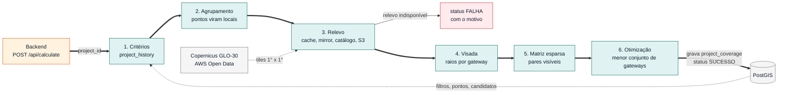
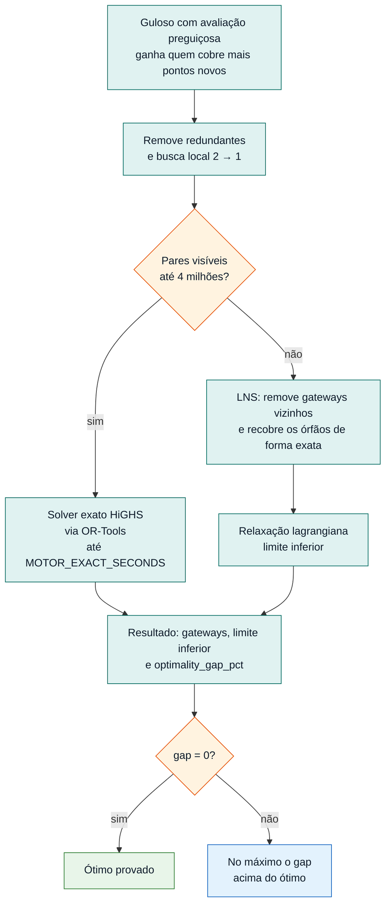

# Motor de decisão

Serviço Spring Boot (Java 17) que responde à pergunta central do projeto: **qual o menor número de gateways, e onde instalá-los, para cobrir os pontos de consumo de uma área**, considerando o relevo.

## 1. O que faz e com quem conversa

| Interlocutor | Direção | Canal | Finalidade |
|---|---|---|---|
| Backend | entrada | `POST /api/calculate` com `{"project_id": N}` (porta 8082) | Solicita o cálculo de um projeto |
| PostGIS | leitura e escrita | JDBC (pool de 3) | Lê critérios (`project_history`), pontos e candidatos; grava `project_coverage` e `projects.status` |
| Copernicus DEM GLO-30 (AWS Open Data) | saída | HTTPS público, sem chave | Relevo em tiles COG de 1° x 1° |
| Cache / mirror local | leitura e escrita | Volume `tecsys-dem-cache`; `DEM_MIRROR_DIR` opcional (somente leitura) | Evitar downloads repetidos |

O motor **não tem autenticação**. Por padrão escuta em `127.0.0.1` (`MOTOR_BIND_ADDRESS`); no `docker-compose` escuta em `0.0.0.0` dentro do container, mas a porta é publicada apenas em `127.0.0.1`. Não exponha a porta 8082 externamente.

Ciclo de status do projeto: `PROCESSANDO` durante o cálculo, depois `SUCESSO` ou `FALHA` (inclusive para `Error` da JVM, como falta de memória). O resultado gravado em `project_coverage` (`summary`, `gateways`, `points`) é o mesmo formato consumido pelo relatório e pelo mapa.

Caminho de um cálculo, do pedido do backend ao resultado gravado:



## 2. Como executar e testar

```bash
./scripts/run-motor.sh                 # contra o PostGIS local (porta 8082)
./scripts/run-motor.sh --db supabase   # contra o Supabase (lê MOTOR/.env.supabase)
./scripts/run-motor.sh --stop
```

- Banco: `DB_URL`, `DB_USER`, `DB_PASSWORD` em `MOTOR/.env.properties` (ou `.env.supabase`). O `run-motor.sh` também repassa ao container toda linha `MOTOR_*` e `DEM_*` do arquivo de ambiente.
- Relevo: o motor baixa os tiles do AWS Open Data **sem chave de API**. O mirror local/NAS é opcional:

  ```properties
  DEM_MIRROR_DIR=/mnt/tecsys-dem-mirror
  ```

  Para semear o mirror: `./scripts/sync-dem-mirror.sh --mirror-dir DIR --bbox S,N,W,E`. Operação do mirror, cache, NAS e licença em [`docs/MOTOR_RELEVO_AWS.md`](../docs/MOTOR_RELEVO_AWS.md).
- Ordem do `up-local.sh`: o motor sobe depois do backend, que aplica as migrations (inclusive `project_coverage`).
- Sem relevo disponível, o projeto termina em `FALHA` com o motivo no log.

Execução direta (sem Docker), a partir de `MOTOR/`:

```bash
DB_URL=jdbc:postgresql://localhost:5433/tecsys DB_USER=tecsys DB_PASSWORD=tecsys mvn spring-boot:run
```

Testes:

```bash
cd MOTOR
mvn test -Dtest='*,!MotorApplicationTests'            # unitários e de integração local, sem banco e sem rede
mvn test -Dtest=MotorApplicationTests                 # sobe o contexto Spring; exige DB_URL, DB_USER e DB_PASSWORD
mvn test -Dtest=DemServiceNetworkTest -DexcludedGroups=   # teste de rede (opt-in), acessa o S3
```

Há testes para `SetCover`, `MotorEngine`, `Radio`, `LineOfSight`, `GeoTiffReader` e `DemService`. O fixture real de relevo está em `src/test/resources/dem/aws-copernicus/` (metadados em `SOURCE.md`).

## 3. Resumo de funcionalidades

- **Seleção de dados.** Pontos a cobrir: consumidores `ucbt`, `ucmt_pj` e `ucat_pj` que satisfazem os filtros do projeto (área, município, conjunto, subestação, classe, CNAE, bairro). Candidatos a gateway: transformadores `untrmt` e `untrat`, incluindo trafos fora da área mas ao alcance dela (marcados com `outside_filters: true`, #TG-138). O filtro de bairro usa `ILIKE '%nome%'`, a mesma regra do mapa (#TG-98).
- **Agrupamento em locais.** Pontos na mesma posição e mesma altura têm a mesma cobertura e viram um único local (em São José dos Campos, 31 mil pontos viram 18,7 mil locais). O peso do local é o número de pontos, e o de `ucbt` considera `qtd_consumidores`.
- **Relevo.** Copernicus GLO-30 (30 m) lido como float32 (metros reais), com interpolação bilinear.
- **Visada.** Para cada candidato, calcula quais locais ele enxerga, com curvatura da Terra e refração.
- **Orçamento de enlace.** Alcance derivado de frequência, potência, sensibilidade, ganhos, perdas e horizonte de rádio; tudo parametrizável.
- **Otimização.** Menor conjunto de gateways que cobre os pontos cobríveis, com limite inferior e gap de otimalidade.
- **Resultado.** Gateways em ordem de ganho, curva de cobertura acumulada, pontos cobertos e não cobertos. O `summary` inclui `gateway_range_m`, `lower_bound_gateways` e `optimality_gap_pct` (`0` indica ótimo provado).

### Perfis e parâmetros

`MOTOR_PROFILE` escolhe a base (padrão `tecsys`).

| Perfil | Finalidade | Alcance | Alturas | Visada |
|---|---|---|---|---|
| `tecsys` | Modelo do parceiro (documento *API_relevo_doc*) | FSPL ≤ orçamento de 141 dB e horizonte de rádio (~19,3 km) | gateway 6 m, sensor 5 m | Raios a cada 30 m, com curvatura |
| `compat-preciso` | Premissas do motor anterior, com visada precisa | 4 km fixo | Por estrutura da BDGD | Perfil a cada 30 m, com curvatura |
| `compat` | Réplica do motor anterior | 4 km fixo | Por estrutura da BDGD | 5 amostras, pixel mais próximo, folga de 1,5 m |

Nenhum valor de RF fica fixo no código. Qualquer campo do perfil pode ser sobrescrito por variável de ambiente (`MOTOR/.env.properties` ou direto no container); valor vazio mantém o do perfil.

| Variável | `tecsys` | Significado |
|---|---|---|
| `MOTOR_FREQUENCY_MHZ` | 915 | Frequência |
| `MOTOR_TX_POWER_DBM` | 21 | Potência de transmissão |
| `MOTOR_SENSITIVITY_DBM` | −120 | Sensibilidade do receptor |
| `MOTOR_ANTENNA_GAINS_DB` | 0 | Ganho das antenas (Tx + Rx) |
| `MOTOR_EXTRA_LOSS_DB` | 0 | Perdas extras (vegetação, obstáculos) |
| `MOTOR_GATEWAY_HEIGHT_M` / `MOTOR_SENSOR_HEIGHT_M` | 6 / 5 | Alturas das antenas |
| `MOTOR_BDGD_HEIGHTS` | false | Alturas por estrutura da BDGD (gateway 15 / 10,5 / 3,5 m; pontos 10 / 6 / 3 m) |
| `MOTOR_FIXED_RANGE_M` | n/a | Alcance fixo; ignora o orçamento |
| `MOTOR_MAX_RANGE_M` | n/a | Teto de alcance |
| `MOTOR_LINE_OF_SIGHT` | `RAYS` | `RAYS`, `PROFILE` ou `TEAM` |
| `MOTOR_LOS_STEP_M` | 30 | Passo da visada |
| `MOTOR_FRESNEL_FRACTION` | 0 | Fração da 1ª zona de Fresnel que deve ficar livre (0,6 = projeto conservador) |
| `MOTOR_EARTH_CURVATURE` / `MOTOR_REFRACTION_K` | true / 4/3 | Curvatura da Terra e refração |
| `MOTOR_NEIGHBOR_CANDIDATES` | true | Trafos ao alcance da área (#TG-138) |
| `MOTOR_EXACT_SECONDS` | 180 | Tempo do solver exato (0 = só heurística) |
| `MOTOR_USE_TERRAIN` | true | `false` = terreno plano, somente para teste de UI |
| `MOTOR_THREADS` | 0 | Threads da visada (0 = núcleos − 1) |

No perfil `tecsys`, `gateway_range_m` é o horizonte de rádio (~19 km), não um raio fixo de 4 km. Lista completa de variáveis em `src/main/resources/application.yml`.

## 4. Decisões técnicas e arquitetura

### Pipeline de cálculo

1. **Critérios e validação.** `DecisionService` lê o projeto e o histórico (aguarda até 5 s o commit do backend, #TG-96) e rejeita projetos sem área, município, conjunto ou subestação, para não varrer a distribuidora inteira.
2. **Agrupamento** em locais (`MotorEngine`).
3. **Relevo** (`DemService`, `GeoTiffReader`, `GridTerrain`): ordem de busca cache → mirror → catálogo → S3, com validação do tile antes de entrar no cache.
4. **Visada** (`RayViewshed`, `LineOfSight`): padrão por viewshed de raios, cerca de 4 mil raios por gateway acumulando o maior ângulo de elevação do terreno. O custo cresce com a área, não com o número de pares candidato–ponto. Candidatos são processados em paralelo (`CoverageBuilder`).
5. **Matriz de cobertura** (`CoverageMatrix`): matriz esparsa em formato colunar (`colPtr`, `rows`), que armazena apenas os pares (candidato, local) visíveis. Não usa `BitSet`.
6. **Otimização** (`SetCover`), problema de cobertura de conjuntos:
   1. guloso com avaliação preguiçosa (heap), ponderado pelo peso de cada local;
   2. remoção de gateways redundantes e busca local 2→1;
   3. até 4 milhões de pares visíveis, solver exato **HiGHS** via OR-Tools, que prova o ótimo ou fornece um limite inferior;
   4. acima disso, LNS (remove gateways vizinhos e recobre os pontos órfãos de forma exata) e relaxação lagrangiana para o limite inferior.
7. **Persistência** em `project_coverage` e atualização do status.

Decisão do otimizador (passo 6):



| Pacote | Conteúdo |
|---|---|
| `engine/MotorEngine` | Orquestração, alturas, agrupamento |
| `engine/MotorParams`, `MotorProperties` | Perfis e parâmetros (`app.motor.*`) |
| `engine/Radio`, `Geo` | FSPL, orçamento de enlace, horizonte, Fresnel, projeção local |
| `engine/LineOfSight`, `RayViewshed` | Visada par a par e viewshed por raios |
| `engine/CoverageBuilder`, `CoverageMatrix` | Matriz esparsa de cobertura, em paralelo |
| `engine/SetCover` | Guloso, redundância, busca local, HiGHS, LNS, lagrangiano |
| `terrain/DemService`, `GeoTiffReader`, `TileCatalog` | Download AWS, cache, mirror, catálogo de tiles, mosaico e leitura float32 |
| `DecisionRepository`, `Project*Repository` | Consultas ao PostGIS e atualização de status |

### Relevo e cache

- Fonte: Copernicus DEM GLO-30 no AWS Open Data, tiles COG de 1° x 1°, sem chave e sem cota diária.
- Cache: volume Docker `tecsys-dem-cache` (`<DEM_CACHE_DIR>/aws-copernicus/<tile>/<tile>.tif`); fora do Docker, `cache/dem`.
- Tile fora do catálogo da AWS (`copernicus-glo30-tilelist.txt.gz`) é mar: vira grade de 0 m sem consultar o S3. Ponto ou candidato em tile de mar é erro de coordenada e falha o cálculo.
- O perfil `tecsys` exige relevo numa margem de ~19 km ao redor da área.
- Domínio suportado: latitude −50° a +50°, longitude −180° a +180°, sem cruzar o antimeridiano.
- **Falha explícita.** Se o relevo não puder ser obtido, o projeto termina em `FALHA`. Não há queda silenciosa para terreno plano.
- Atribuição obrigatória do Copernicus DEM em materiais que usem o relevo: ver [`docs/MOTOR_RELEVO_AWS.md`](../docs/MOTOR_RELEVO_AWS.md#licença-e-atribuição).

### Mudanças em relação ao motor anterior

| Problema do motor anterior | Solução atual |
|---|---|
| #TG-132: GeoTIFF lido como imagem RGB de 8 bits (714 m virava 126), gerando morros falsos e de 3,4 a 21 vezes mais gateways | Leitura float32 com `getRasterData` |
| #TG-97: sem chave ou com cota esgotada, calculava em terreno plano e marcava `SUCESSO`, declarando ~99,9% de cobertura quando a real ficava entre 43% e 69% | Falha com mensagem clara |
| #TG-139: OpenTopography exigia chave e tinha cota diária | Copernicus GLO-30 no AWS Open Data, com mirror local opcional |
| Visada com 5 amostras e pixel mais próximo: morros entre as amostras passavam despercebidos | Perfil a cada 30 m, bilinear, com curvatura da Terra |
| O guloso parava na primeira solução | Busca local e solver exato (ótimo provado ou limite inferior) |
| Alcance fixo de 4 km no código | Orçamento de enlace e horizonte de rádio, parametrizáveis |
| #TG-138: trafo logo fora da área nunca era candidato | Candidatos ao alcance da área |
| #TG-98: bairro comparado por igualdade exata, enquanto o mapa usa `ILIKE` | Mesma regra do mapa |
| #TG-96: o motor podia ler o projeto antes do commit do backend | Espera até 5 s pelo projeto |
| #TG-134: erro grave (ex.: falta de memória) deixava o projeto em `ENVIADO` | Marca `FALHA` também nesse caso |

### Imagem Docker

`eclipse-temurin:17-jre-jammy` em vez de Alpine, porque o OR-Tools traz bibliotecas nativas que exigem glibc (imagem de ~210 MB para ~400 MB).

### Desempenho medido

EDP SP (distribuidora 391), PostGIS local, 8 núcleos, em 05/11/2026. A coluna Python é o motor de referência que deu origem a este, com os mesmos dados.

| Cenário | Perfil | Gateways | Limite inferior | Cobertura | Tempo | Python |
|---|---|---|---|---|---|---|
| Caçapava (3.849 pontos) | `tecsys` | 22 | 22 (ótimo) | 100% | 24 s | 22 gw, 154 s |
| Caçapava | `compat` | 23 | 23 (ótimo) | 99,97% | 92 s | 23 gw, 78 s |
| São José dos Campos (31.084 pontos) | `tecsys` | 211 | 202–203 | 100% | 4 min | 211 gw, 18 min |

Memória de pico do container em São José dos Campos: ~1,9 GB.
