# Manual do usuário — Tecsys

Este manual mostra como usar o sistema para planejar onde instalar gateways LoRa: quantos são necessários, onde ficam e quantos consumidores eles atendem.

Os textos seguem a ajuda que existe dentro do próprio sistema. Em qualquer tela, o botão **?** ao lado do título abre a mesma explicação. Nos filtros do mapa e nos campos técnicos, passe o mouse sobre o botão ou sobre o ícone **ⓘ** para ver o que cada um faz.

> Como instalar e subir o sistema está no [README do projeto](../README.md). Este manual cobre só o uso.

## Sumário

1. [Primeiro estudo em 5 passos](#1-primeiro-estudo-em-5-passos)
2. [Entrar no sistema](#2-entrar-no-sistema)
3. [Projetos](#3-projetos)
4. [Novo projeto](#4-novo-projeto)
5. [Mapa do projeto](#5-mapa-do-projeto)
6. [Relatório de cobertura](#6-relatório-de-cobertura)
7. [Versões e recálculo](#7-versões-e-recálculo)
8. [Perfis de gateway](#8-perfis-de-gateway)
9. [ETL & Geodados (administrador)](#9-etl--geodados-administrador)
10. [Usuários (administrador)](#10-usuários-administrador)
11. [Dúvidas comuns](#11-dúvidas-comuns)

---

## 1. Primeiro estudo em 5 passos

Para quem nunca usou o sistema:

1. Entre com o e-mail e a senha que o administrador passou. No primeiro acesso, troque a senha ([seção 2](#2-entrar-no-sistema)).
2. Na tela **Projetos**, clique em **Novo Projeto**, dê um nome, escolha a distribuidora e marque a cidade. Deixe o perfil **Tecsys (padrão)** e clique em **Buscar** ([seção 4](#4-novo-projeto)).
3. O mapa abre com todos os consumidores da cidade. Não precisa mexer em nada: clique em **Salvar Projeto** ([seção 5](#5-mapa-do-projeto)).
4. Aguarde o cálculo. A tela mostra "Cálculo em andamento" e troca sozinha quando termina. Uma cidade pequena leva menos de 1 minuto.
5. O relatório abre com a cobertura, o número de gateways e o lugar de cada um. Para guardar, clique no ícone de PDF no canto superior direito ([seção 6](#6-relatório-de-cobertura)).

---

## 2. Entrar no sistema

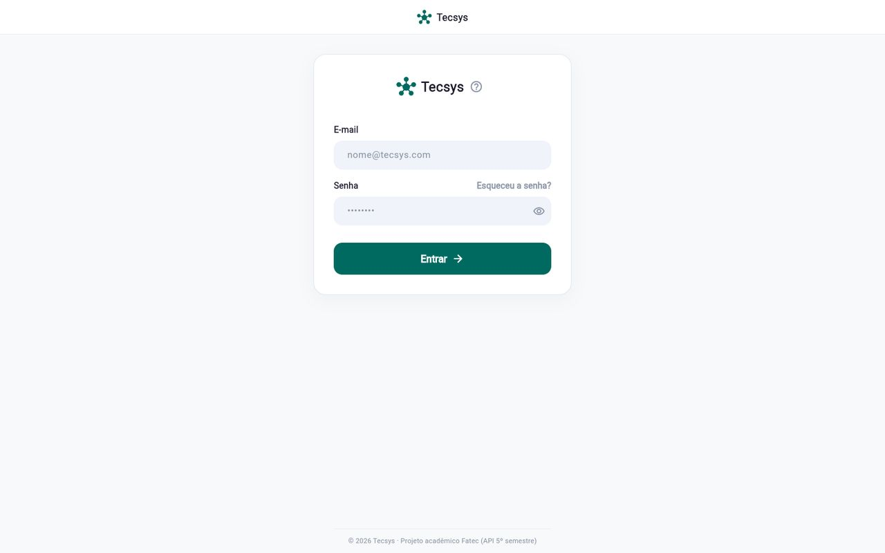

O acesso é feito com o e-mail e a senha cadastrados por um administrador.

1. Digite o e-mail e a senha e clique em **Entrar**.
2. No primeiro acesso, o sistema pede para trocar a senha provisória por uma senha sua.
3. A sessão vale por 2 horas. Depois disso, o sistema volta para esta tela e avisa que a sessão expirou.

O **?** ao lado do nome Tecsys abre esta mesma explicação:

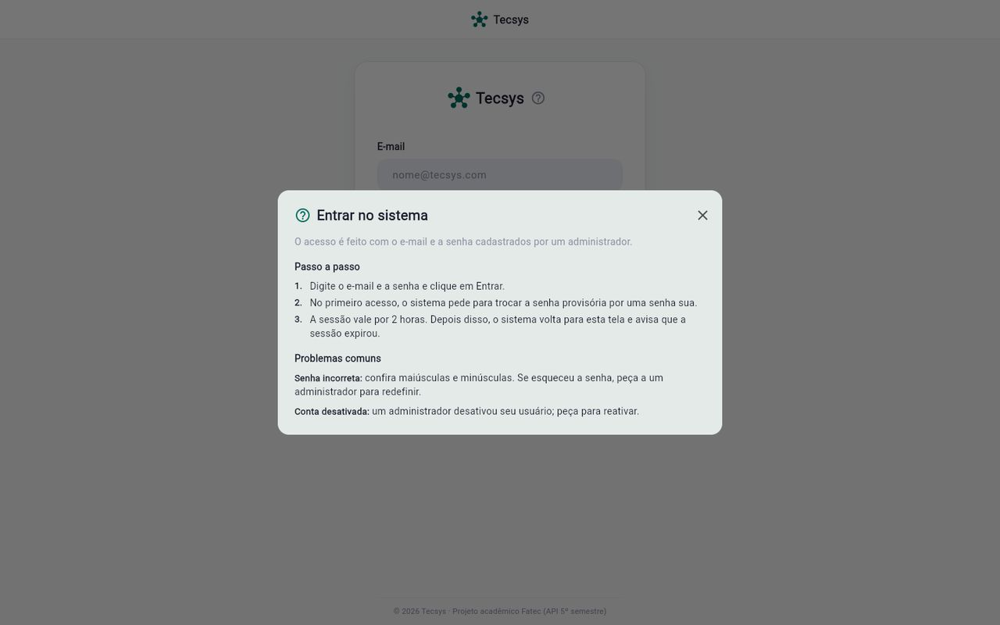

### Primeiro acesso: trocar a senha

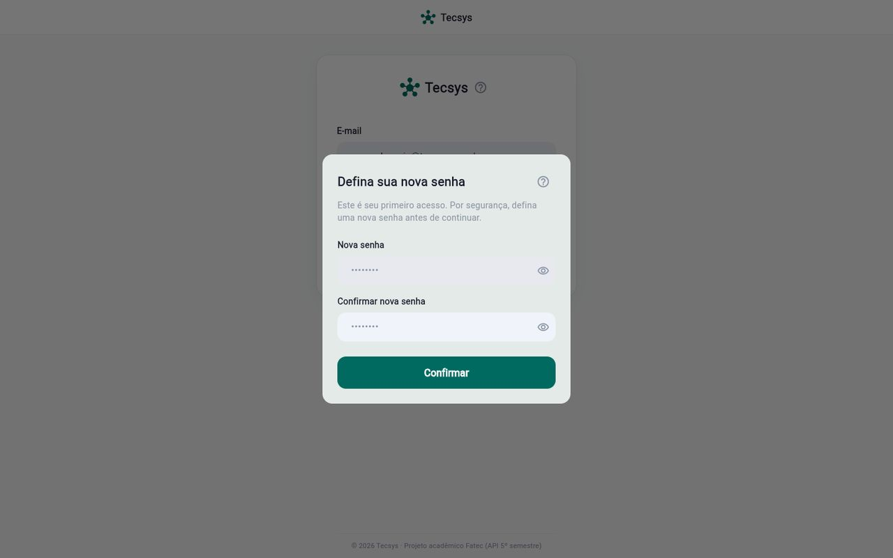

No primeiro acesso, a senha provisória precisa ser trocada antes de usar o sistema.

1. Digite a senha nova (mínimo de 6 caracteres) e repita no campo de confirmação.
2. Clique em **Confirmar**. O sistema abre em seguida, já com a senha nova.

### Problemas comuns

- **Senha incorreta:** confira maiúsculas e minúsculas. Se esqueceu a senha, fale com um administrador do sistema.
- **Conta desativada:** um administrador removeu seu acesso; fale com ele.

### Sair

O ícone redondo no canto superior direito abre o menu da conta. **Sair** encerra a sessão.

---

## 3. Projetos

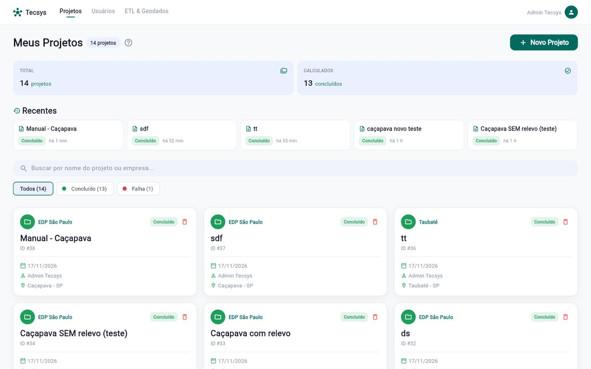

Cada projeto é um estudo de onde instalar gateways para cobrir os pontos de uma área. Aqui ficam todos os projetos, do mais recente para o mais antigo.

1. Clique em **Novo Projeto** para começar um estudo.
2. Use a seção **Recentes** para voltar rápido aos últimos projetos que você mexeu.
3. Clique em um projeto concluído para abrir o relatório; nos demais status, ele abre no mapa.
4. Use a busca e o filtro de status para achar um projeto na lista.

O ícone de lixeira no card apaga o projeto.

### Status do projeto

| Status | O que significa |
|---|---|
| **Criado / Enviado** | o projeto foi salvo e está na fila do cálculo. |
| **Processando** | o motor está calculando. Áreas grandes levam alguns minutos; a tela atualiza sozinha. |
| **Concluído** | o cálculo terminou; o relatório está disponível. |
| **Falha** | o cálculo não terminou. O relatório mostra o motivo; ajuste e recalcule. |

---

## 4. Novo projeto

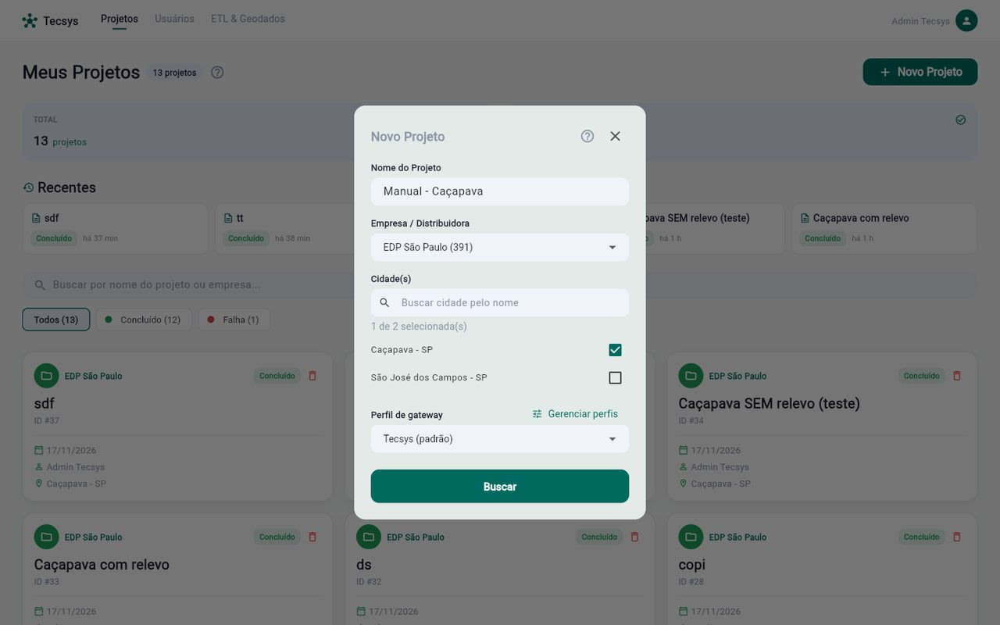

Define o nome, a área de estudo e o perfil de rádio do gateway. Depois, o mapa abre para ajustar os filtros.

1. Dê um nome ao projeto.
2. Escolha a distribuidora. Aparecem só as que têm dados carregados (rede da BDGD ou pontos de planilha).
3. Marque uma ou mais cidades da distribuidora. A busca acima da lista filtra as cidades pelo nome.
4. Confira o perfil de gateway. O perfil padrão (Tecsys) já vem escolhido; troque se quiser simular outro equipamento.
5. Clique em **Buscar** para abrir o mapa.

- **Perfil de gateway:** parâmetros de rádio usados no cálculo (frequência, potência, sensibilidade, alturas). Em **Gerenciar perfis** você cria e edita perfis ([seção 8](#8-perfis-de-gateway)).

> A distribuidora ou a cidade não aparece? Os dados dela ainda não foram carregados. Um administrador carrega pela tela [ETL & Geodados](#9-etl--geodados-administrador).

---

## 5. Mapa do projeto

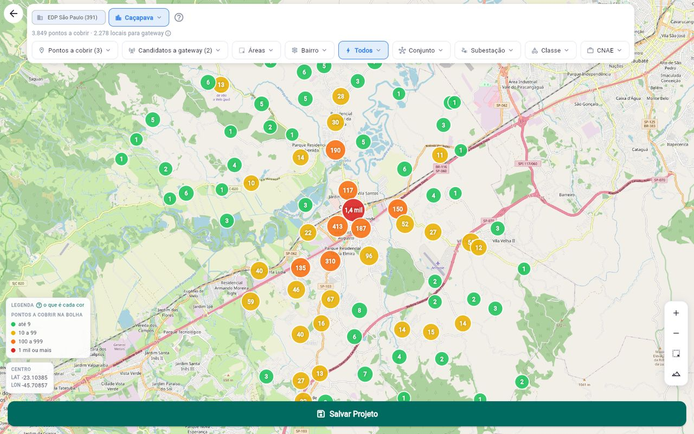

Aqui você escolhe quais pontos entram no cálculo e onde os gateways podem ser instalados. Ao salvar, o motor calcula o menor número de gateways que cobre esses pontos.

1. Confira a distribuidora e as cidades no topo. Clique nas cidades para incluir ou tirar uma.
2. Acompanhe o contador abaixo delas: ele mostra quantos pontos vão ser cobertos e quantos locais podem receber gateway.
3. Refine com os filtros (pontos a cobrir, candidatos, áreas, bairro, tensão, conjunto, subestação, classe e CNAE).
4. Se quiser limitar a uma região, desenhe uma ou mais áreas no mapa.
5. Clique em **Salvar Projeto** (ou **Recalcular**, num projeto aberto). O cálculo roda em segundo plano.

O **?** ao lado das cidades abre a ajuda completa do mapa, com filtros, legenda e desenho de área:

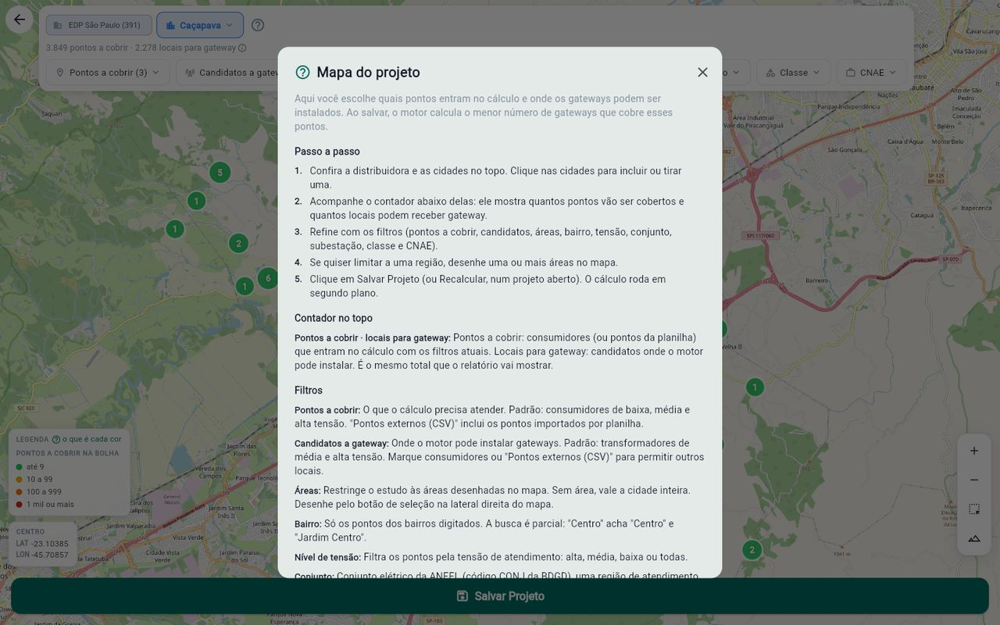

### Contador no topo

**Pontos a cobrir · locais para gateway:** pontos a cobrir são os consumidores (ou pontos da planilha) que entram no cálculo com os filtros atuais. Locais para gateway são os candidatos onde o motor pode instalar. É o mesmo total que o relatório vai mostrar.

Se o contador mostrar 0 pontos a cobrir, o botão de salvar fica desligado e o mapa avisa para ajustar as cidades, a área ou os filtros.

### Filtros

Cada filtro abre um painel. O texto no topo do painel explica o filtro, e passar o mouse sobre o botão mostra o mesmo texto.

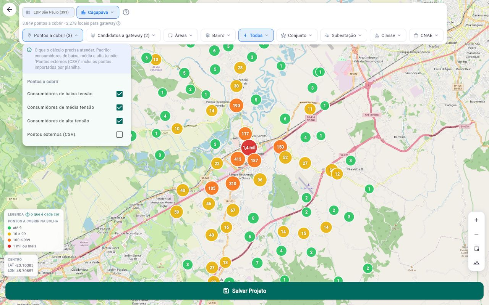

| Filtro | O que faz |
|---|---|
| **Pontos a cobrir** | O que o cálculo precisa atender. Padrão: consumidores de baixa, média e alta tensão. "Pontos externos (CSV)" inclui os pontos importados por planilha. |
| **Candidatos a gateway** | Onde o motor pode instalar gateways. Padrão: transformadores de média e alta tensão. Marque consumidores ou "Pontos externos (CSV)" para permitir outros locais. |
| **Áreas** | Restringe o estudo às áreas desenhadas no mapa. Sem área, vale a cidade inteira. Desenhe pelo botão de seleção na lateral direita do mapa. |
| **Bairro** | Só os pontos dos bairros digitados. A busca é parcial: "Centro" acha "Centro" e "Jardim Centro". |
| **Nível de tensão** | Filtra os pontos pela tensão de atendimento: alta, média, baixa ou todas. |
| **Conjunto** | Conjunto elétrico da ANEEL (código CONJ da BDGD), uma região de atendimento da distribuidora. |
| **Subestação** | Só os pontos atendidos pelas subestações informadas (código da subestação). |
| **Classe** | Classe de consumo: residencial, comercial, industrial, rural, poder público e outras. |
| **CNAE** | Atividade econômica do consumidor (código CNAE). |

Os papéis são independentes da tensão: um mesmo tipo de ponto pode ser ponto a cobrir, candidato ou os dois. O filtro **Candidatos a gateway** mostra isso:

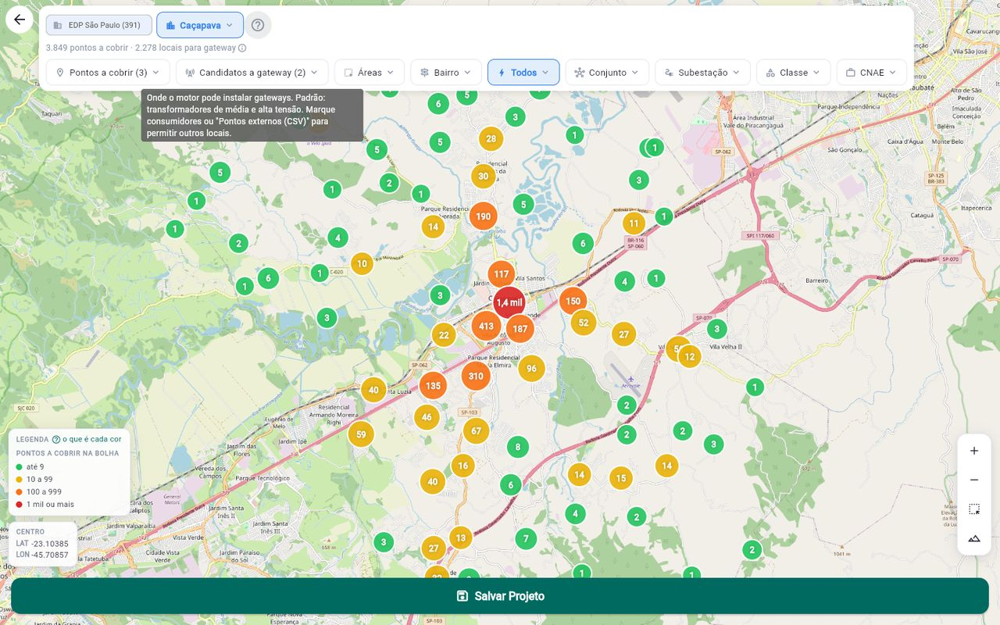

### Legenda

A legenda fica no canto inferior esquerdo e muda conforme o zoom. Clique em **? o que é cada cor** para abrir a explicação completa.

**Mapa afastado (bolhas).** Cada bolha agrupa os pontos a cobrir de uma região; o número é quantos pontos ela tem. Clique na bolha (ou dê zoom) para ver os pontos. A cor indica o tamanho:

| Cor | Pontos a cobrir na bolha |
|---|---|
| verde | até 9 |
| amarelo | 10 a 99 |
| laranja | 100 a 999 |
| vermelho | 1 mil ou mais |

**Mapa de perto (pontos).**

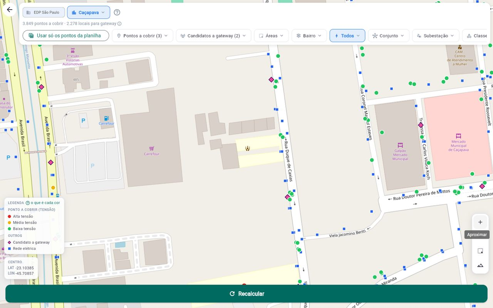

| Marca | Significado |
|---|---|
| ● vermelho | **Ponto de alta tensão:** consumidor atendido em alta tensão. |
| ● amarelo | **Ponto de média tensão:** consumidor atendido em média tensão. |
| ● verde | **Ponto de baixa tensão:** consumidor de baixa tensão (casas e comércios). Um ponto pode reunir vários consumidores no mesmo endereço. |
| ◆ rosa | **Candidato a gateway:** local onde o motor pode instalar um gateway (por padrão, transformadores). |
| ■ azul | **Rede elétrica:** linhas e equipamentos da rede, só para referência; não entram no cálculo. |
| ■ verde | **Área desenhada:** região escolhida para o estudo; os pontos dentro dela ficam destacados. |

Clique em um ponto para ver classe, bairro, subestação e outros dados.

### Desenhar uma área

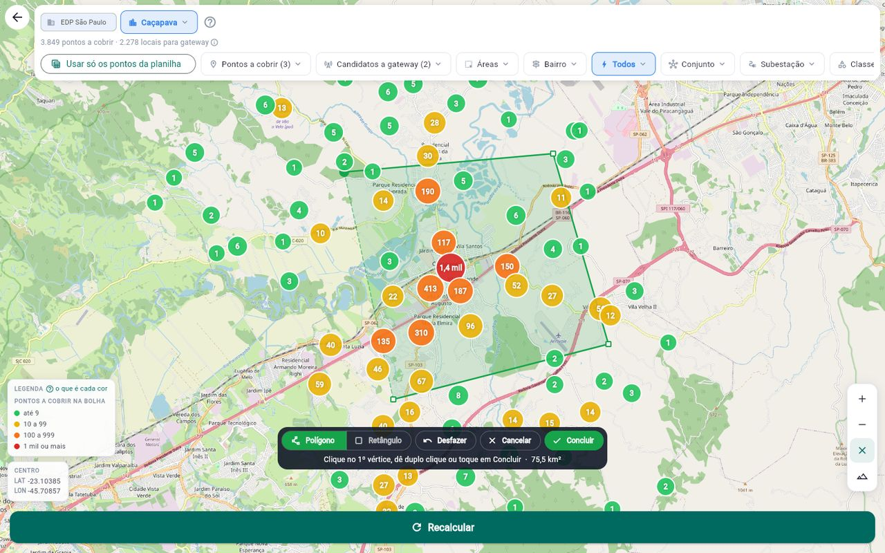

Clique no botão de seleção na lateral direita (o quadrado tracejado). A barra de desenho aparece embaixo do mapa.

- **Polígono:** clique no mapa para marcar cada vértice; feche clicando no 1º vértice, com duplo clique ou em **Concluir**. **Desfazer** (Backspace) remove o último ponto; Esc cancela.
- **Retângulo:** escolha "Retângulo" na barra e arraste no mapa.
- **Várias áreas:** desenhe quantas quiser. No filtro Áreas você vê o total de cada uma, foca ou remove.

A barra mostra a área em km² enquanto você desenha.

### Rede independente (planilha)

Uma rede independente é um conjunto de pontos que não vem da distribuidora, importado por planilha CSV ([seção 9](#9-etl--geodados-administrador)).

- **Só a planilha:** quando a cidade não tem rede da distribuidora carregada, o mapa já abre usando só os pontos do CSV.
- **Usar só os pontos da planilha:** aparece quando a cidade tem pontos de planilha. Calcula só com os pontos da planilha: eles passam a ser os pontos a cobrir e os candidatos a gateway, e a rede da distribuidora é ignorada.

### Botões na lateral direita

- **+ e −:** aproximar e afastar.
- **Seleção de área:** liga o modo de desenho de área.
- **Lixeira:** aparece com uma área selecionada; apaga só ela.
- **Relevo:** mostra o relevo do terreno por cima do mapa (só visual; o cálculo sempre considera o relevo).

### Salvar e calcular

Ao clicar em **Salvar Projeto**, o sistema volta para a lista de projetos com o projeto em **Enviado**. Ao abrir o projeto durante o cálculo, a tela mostra:

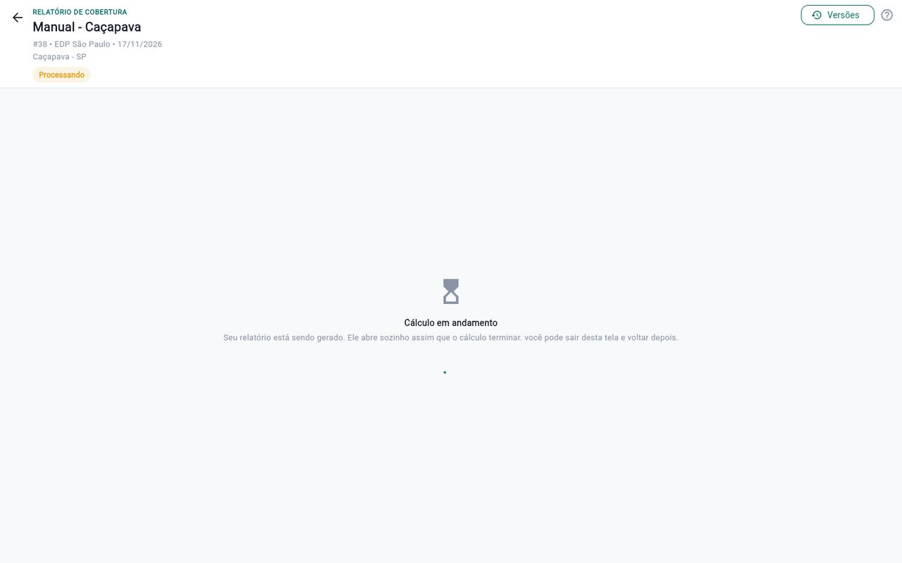

Você pode sair dessa tela e voltar depois. O relatório abre sozinho quando o cálculo termina.

---

## 6. Relatório de cobertura

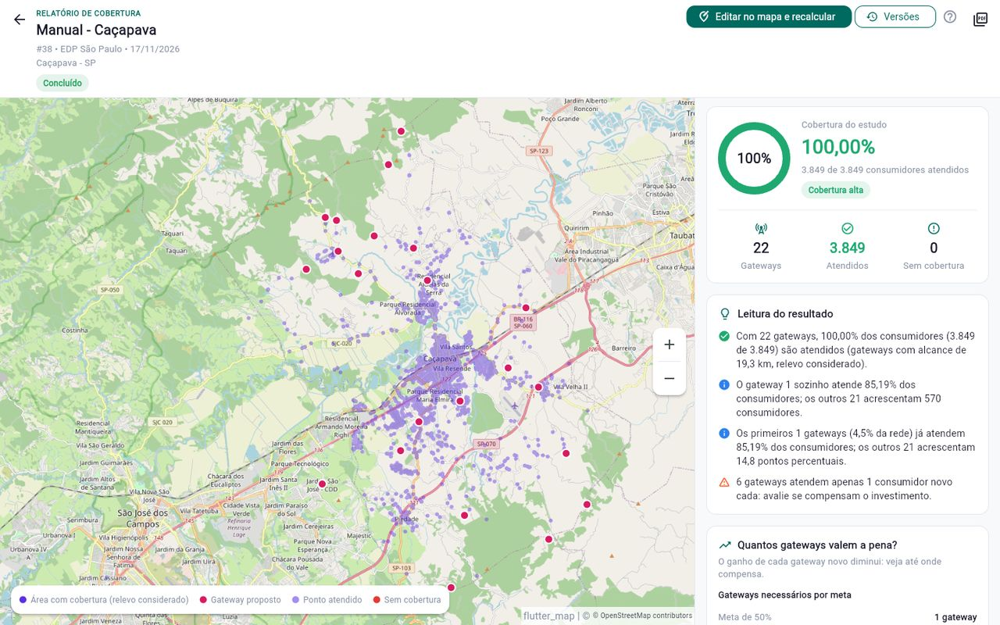

Resultado do cálculo: quantos gateways instalar, onde, e quantos consumidores ficam atendidos.

1. Leia o resumo no topo: cobertura e número de gateways.
2. Veja no mapa a mancha de cobertura e os gateways propostos.
3. Confira a lista de gateways, na ordem em que mais acrescentam cobertura.
4. Exporte em PDF pelo botão no canto superior direito.
5. Para mudar filtros, área ou perfil, use **Editar no mapa e recalcular**. Cada recálculo vira uma nova versão (botão **Versões**).

### Indicadores

- **Cobertura:** porcentagem dos consumidores analisados que algum gateway alcança.
- **Gateways:** menor número de gateways encontrado para essa cobertura.
- **Sem cobertura:** consumidores que nenhum candidato alcança (relevo, distância). Avalie novos candidatos nessa região.
- **Leitura do resultado:** frases que resumem o estudo, por exemplo quanto o primeiro gateway sozinho atende e quantos gateways atendem um único consumidor.
- **Curva de eficiência** ("Quantos gateways valem a pena?"): quanto cada gateway acrescenta. Os primeiros costumam cobrir a maior parte; os últimos, poucos consumidores. A tabela mostra quantos gateways são necessários para 50%, 80%, 90% e 95% de cobertura.

### Mapa do relatório

- **Mancha roxa:** área onde o sinal chega, considerando o relevo.
- **Marcador:** gateway proposto. Clique para ver os dados.
- **Ponto vermelho:** consumidor sem cobertura.

### Gateways propostos

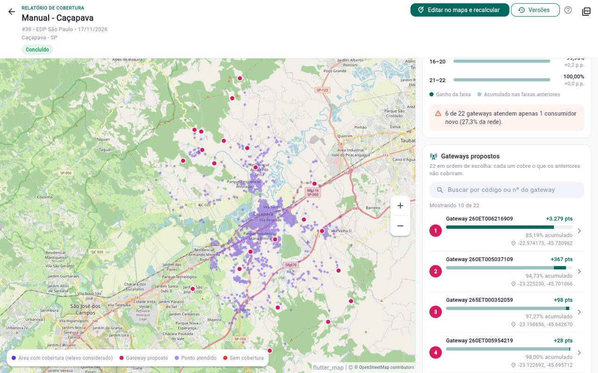

Os gateways aparecem na ordem de escolha: cada um cobre o que os anteriores não cobriram. Cada linha mostra o código do equipamento onde o gateway fica, quantos pontos ele acrescenta, a cobertura acumulada e as coordenadas. Use a busca para achar um gateway pelo código ou pelo número, e **Mostrar mais** para ver o resto da lista.

### Premissas do cálculo

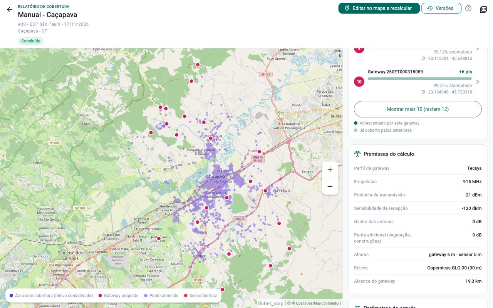

Perfil de gateway, valores de rádio, alturas e relevo usados no cálculo. Servem para saber com quais valores aquele resultado foi gerado. Se o perfil mudar depois, o relatório continua mostrando os valores da época do cálculo.

### Parâmetros do estudo e dados do cálculo

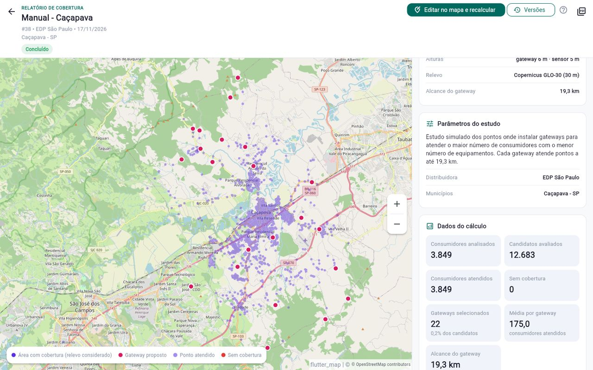

- **Parâmetros do estudo:** distribuidora, municípios e alcance usado.
- **Dados do cálculo:** consumidores analisados, candidatos avaliados, consumidores atendidos, sem cobertura, gateways selecionados, média por gateway e alcance.

### Exportar PDF

O ícone de PDF no canto superior direito gera um PDF com o resumo, a leitura do resultado, as premissas, os dados do cálculo e a lista completa de gateways. Quando o navegador consegue capturar o mapa, ele também entra no PDF.

---

## 7. Versões e recálculo

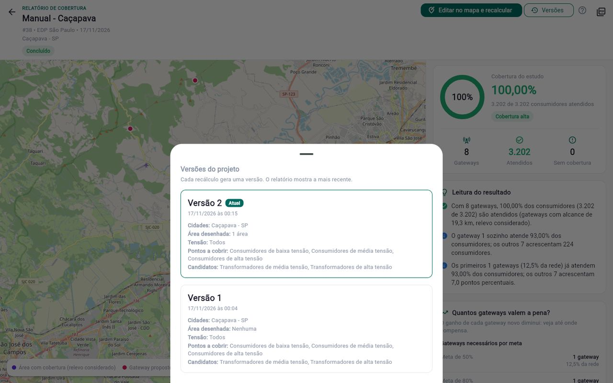

Cada recálculo gera uma versão. O relatório mostra a mais recente.

1. No relatório, clique em **Editar no mapa e recalcular**. O mapa abre com os filtros e as áreas da última versão.
2. Mude o que quiser (cidades, filtros, áreas, perfil) e clique em **Recalcular**.
3. Quando o cálculo terminar, o relatório mostra a nova versão. O botão **Versões** lista todas, com as cidades, a área desenhada, a tensão, os pontos a cobrir e os candidatos de cada uma.

---

## 8. Perfis de gateway

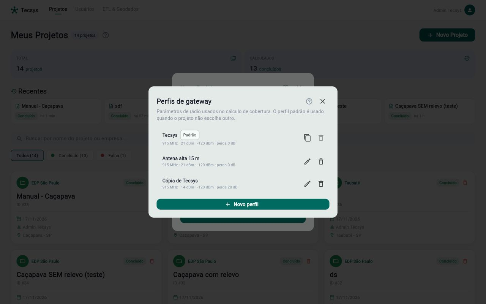

Abra pelo link **Gerenciar perfis** na tela de [Novo projeto](#4-novo-projeto).

Um perfil guarda os parâmetros de rádio de um modelo de gateway. O projeto usa o perfil escolhido no cálculo do alcance.

1. Para criar, clique em **Novo perfil** (ou em **Duplicar** no perfil padrão) e preencha os campos.
2. O perfil padrão (Tecsys) não pode ser alterado: duplique e ajuste a cópia.
3. Um perfil usado em algum projeto não pode ser excluído.

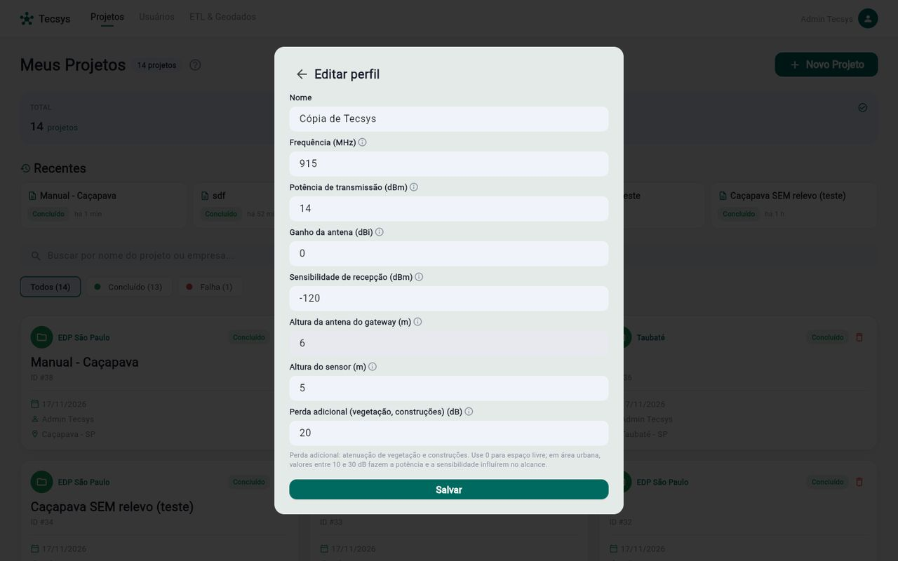

### O que é cada campo

O ícone **ⓘ** ao lado de cada campo mostra a mesma explicação.

| Campo | Explicação |
|---|---|
| **Frequência (MHz)** | Faixa de rádio do equipamento. LoRa no Brasil: 915 MHz. |
| **Potência de transmissão (dBm)** | Força com que o gateway transmite. Quanto maior, mais longe o sinal chega. Comum: 14 a 27 dBm (padrão Tecsys: 21). |
| **Ganho da antena (dBi)** | Reforço que a antena dá ao sinal. Comum: 0 a 6 dBi (padrão Tecsys: 0). |
| **Sensibilidade de recepção (dBm)** | Sinal mais fraco que o rádio ainda consegue ouvir. Quanto MAIS NEGATIVO, melhor o rádio. LoRa: -110 a -140 dBm (padrão Tecsys: -120). |
| **Altura da antena do gateway (m)** | Altura da antena do gateway no poste. Mais alto enxerga mais longe (o horizonte de rádio aumenta). Padrão: 6 m. |
| **Altura do sensor (m)** | Altura em que o sensor fica instalado. Padrão: 5 m. |
| **Perda adicional (dB)** | Quanto árvores e construções enfraquecem o sinal. 0 = campo aberto; 10 a 30 dB em área urbana. Com perda, a potência e a sensibilidade passam a mudar o alcance. |

### Como o alcance é calculado

- **Força do sinal:** potência − sensibilidade + ganho − perda. Quanto maior, mais longe o sinal chega.
- **Horizonte de rádio:** por causa da curvatura da Terra, antenas baixas não se enxergam além de alguns km (≈19 km com 6 m e 5 m).
- **Alcance usado:** o menor dos dois. Além disso, o relevo bloqueia o sinal onde há morros no caminho.

Exemplo: com o perfil padrão (sem perda adicional), o limite é o horizonte de rádio, cerca de 19,3 km. Com 20 dB de perda adicional, a potência e a sensibilidade passam a decidir o alcance, e baixar a potência aumenta o número de gateways.

---

## 9. ETL & Geodados (administrador)

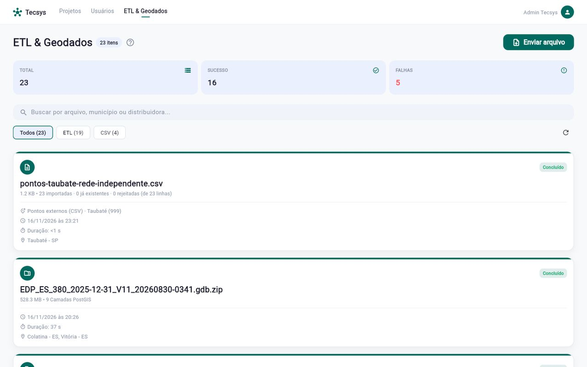

Carrega no sistema os dados da rede elétrica (BDGD da ANEEL) e pontos próprios por planilha CSV. Só administradores veem esta tela.

1. Clique em **Enviar arquivo** e arraste um .zip da BDGD ou um .csv de pontos. O sistema descobre o tipo pelo arquivo.
2. **.zip:** o sistema lê o arquivo, lista as cidades e você escolhe quais carregar (com ou sem baixa tensão).
3. **.csv:** escolha a distribuidora e o município, confira a prévia e importe. Para uma rede sem BDGD, use **+ Outra distribuidora**.
4. Acompanhe o andamento e o resultado no histórico de cargas.

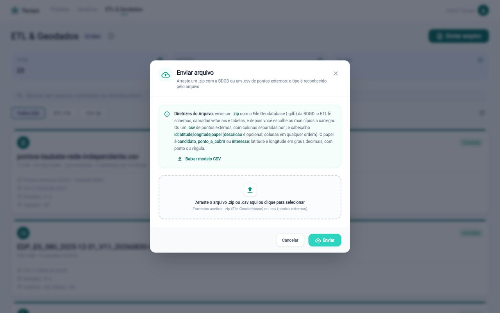

### BDGD (.zip)

A BDGD é a base de dados geográfica que cada distribuidora entrega à ANEEL. Baixe o .zip (File Geodatabase, `.gdb`) da distribuidora no portal de dados abertos da ANEEL e envie aqui. Depois de ler o arquivo, o sistema mostra as cidades encontradas; marque as que quer carregar. Arquivos grandes levam alguns minutos.

### Planilha CSV de pontos

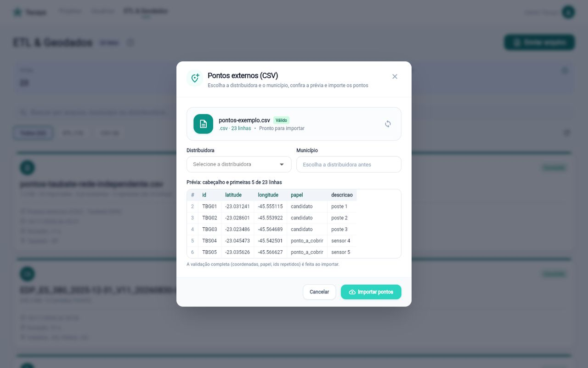

- **Colunas:** `id;latitude;longitude;papel;descricao` (separadas por ponto e vírgula). Baixe o modelo no próprio modal (**Baixar modelo CSV**).
- **papel:** `candidato` (local para gateway), `ponto_a_cobrir` (sensor que precisa de sinal) ou `interesse` (só referência).
- **Linhas rejeitadas:** aparecem no resumo com o motivo (ex.: latitude fora da faixa, id repetido).

Exemplo de arquivo:

```csv
id;latitude;longitude;papel;descricao
TBG01;-23.031241;-45.555115;candidato;poste 1
TBS04;-23.045473;-45.542501;ponto_a_cobrir;sensor 4
```

### Distribuidora nova e rede independente

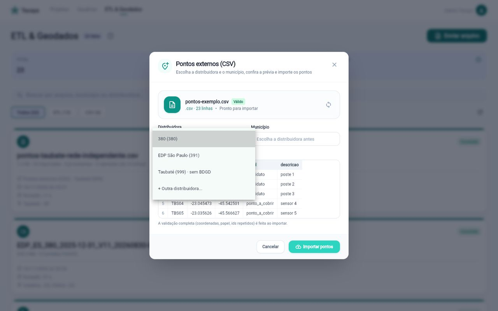

A lista de distribuidoras mostra as que já têm dados. As que só têm pontos de planilha aparecem marcadas como "sem BDGD".

Para uma rede que não pertence a nenhuma distribuidora carregada (por exemplo, a rede própria de um cliente):

1. Escolha **+ Outra distribuidora...** e informe o código e o nome.
2. Digite o município e escolha na lista.
3. Importe a planilha. A distribuidora e a cidade passam a aparecer no [Novo projeto](#4-novo-projeto), e o mapa usa só os pontos do CSV.

### Histórico

- **Detalhes:** mostra o que foi carregado em cada tabela, os avisos e, no CSV, os pontos importados.
- **Cancelar:** descarta um envio que ainda espera a escolha das cidades.

Os botões **Todos**, **ETL** e **CSV** filtram o histórico, e a busca acha um envio pelo nome do arquivo, município ou distribuidora.

---

## 10. Usuários (administrador)

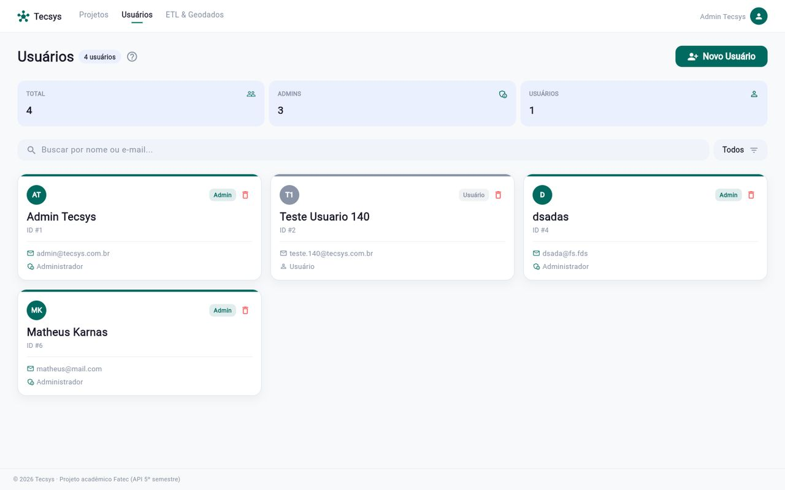

Cadastro de quem acessa o sistema e o que cada um pode fazer. Só administradores veem esta tela.

1. Clique em **Novo Usuário** e informe nome, e-mail, perfil e uma senha inicial.
2. Passe o e-mail e a senha inicial para a pessoa. No primeiro acesso, ela troca a senha.
3. Use a busca e o filtro de perfil para achar um usuário.

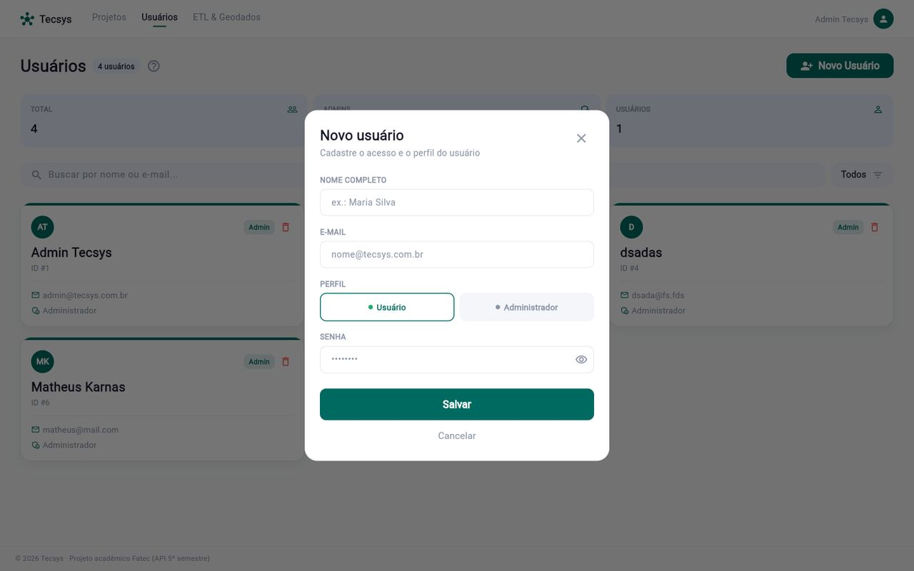

### Perfis

- **Administrador:** acessa tudo, inclusive ETL & Geodados e Usuários.
- **Usuário:** cria e consulta projetos, relatórios e perfis de gateway.

---

## 11. Dúvidas comuns

**A cidade que eu quero não aparece no Novo projeto.**
Os dados dela ainda não foram carregados. Peça a um administrador para enviar a BDGD da distribuidora ou uma planilha CSV de pontos da cidade ([seção 9](#9-etl--geodados-administrador)).

**O botão Salvar Projeto está desligado.**
Nenhum ponto a cobrir com os filtros atuais (o contador mostra 0). Confira as cidades marcadas, as áreas desenhadas e os filtros.

**O cálculo terminou em Falha.**
Abra o projeto: o relatório mostra o motivo. Em geral, a área é grande demais ou não há candidatos. Reduza a área ou libere mais candidatos e recalcule.

**Alguns consumidores ficaram sem cobertura.**
Nenhum candidato alcança esses pontos, por distância ou por morros no caminho. Libere outros candidatos na região (filtro **Candidatos a gateway**) ou use um perfil com antena mais alta.

**Mudei um perfil de gateway. Os relatórios antigos mudam?**
Não. Cada relatório guarda as premissas da época do cálculo. Para ver o efeito do perfil novo, recalcule o projeto.

**A sessão expirou.**
A sessão dura 2 horas. Entre de novo; o projeto salvo continua lá.
